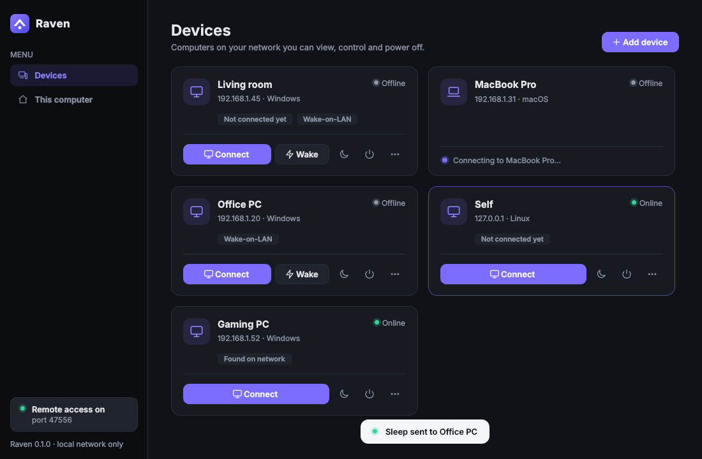
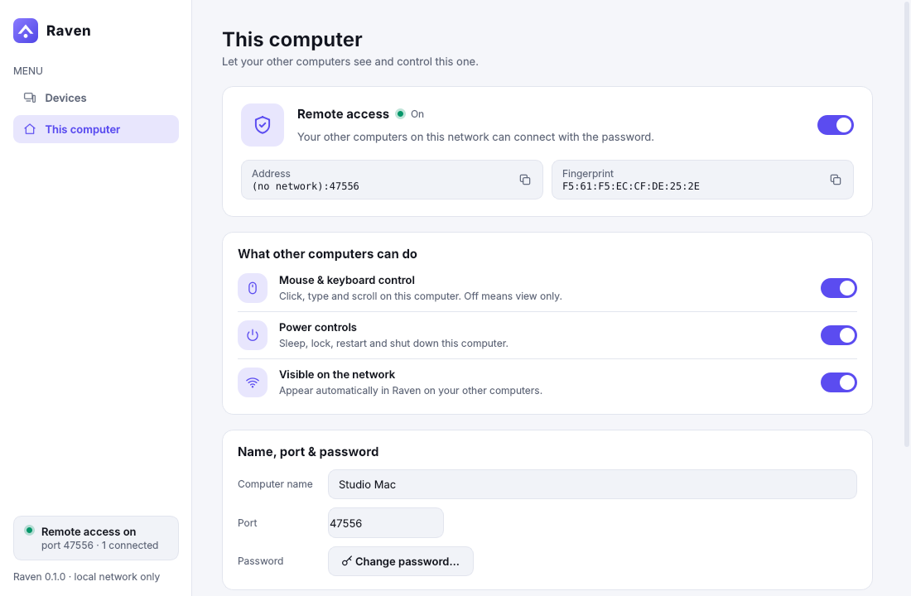
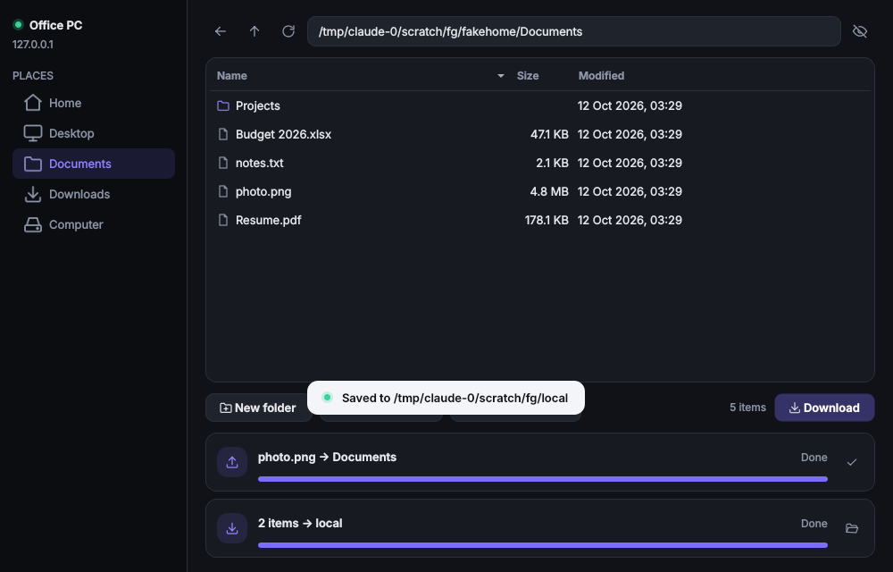

# Raven

Control your own Windows PCs and Macs from each other, **over your local network only**.

- **See the remote desktop** live and **control its mouse and keyboard**
- **Sleep, lock, restart or shut down** a remote computer with one click
- **Transfer files** both ways: browse the remote computer's folders, download files or
  whole folders, upload into any folder, or drop files onto the remote screen
- **Clipboard sync**: copy text or an image on one computer, paste it on the other
- **Wake** a sleeping or powered-off computer with Wake-on-LAN
- Finds other Raven computers on the network automatically (Bonjour/mDNS)
- One app on every machine. Each computer can control others, be controlled, or both

Nothing goes through the internet: there are no accounts, cloud relays or port forwarding.
The host refuses any connection that doesn't come from a private LAN address.



<details><summary>“This computer” page (light theme)</summary>



</details>

The interface follows your system's light or dark mode. Set `RAVEN_THEME=light` or
`RAVEN_THEME=dark` to override it.

## How it works

```
 Controller (any OS)                                   Host (PC or Mac)
┌──────────────────┐   TLS WebSocket, port 47470     ┌────────────────────────┐
│ Viewer window    │ ◀── JPEG frames (mss) ───────── │ screen capture         │
│ mouse / keyboard │ ─── input events ─────────────▶ │ pynput input injection │
│ power buttons    │ ─── sleep / shutdown ─────────▶ │ OS power commands      │
│ files window     │ ◀── file chunks (SHA-256) ────▶ │ file service           │
│ clipboard sync   │ ◀── text / images ────────────▶ │ clipboard hub          │
└──────────────────┘ ◀── Bonjour "_raven._tcp" ──────└────────────────────────┘
        └──── Wake-on-LAN magic packet (UDP broadcast) ──▶ powered-off host
```

Built with Python and PySide6 (Qt), `websockets` over TLS, `mss`, `pynput` and
`zeroconf`. See the [documentation](#documentation) for the details.

## Install and run (from source)

You need Python 3.10 or newer on each computer.

```bash
git clone <this repo> raven && cd raven
python -m venv .venv
# Windows: .venv\Scripts\activate      macOS: source .venv/bin/activate
pip install -e .
raven            # or: python -m raven
```

Ready-made builds: the `build` GitHub Actions workflow produces `Raven-Windows.zip`
(`Raven.exe`) and `Raven-macOS.zip` (`Raven.app`) as artifacts. To build locally:

```bash
pip install -e ".[dev]"
pyinstaller --noconfirm packaging/raven.spec     # → dist/Raven/ or dist/Raven.app
```

## Set up

### On each computer you want to control (the host)

1. Open Raven → **This computer**.
2. Turn on **Remote access** and choose a password. The page then shows this computer's
   address and fingerprint, with copy buttons.
3. Optional: turn on **Start at login** so the computer is reachable again after
   a restart. Closing the window keeps Raven running in the tray/menu bar while remote
   control is on.

**macOS:** grant Raven (or Terminal/Python when running from source) both
**Screen Recording** and **Accessibility** in *System Settings → Privacy & Security*, then
restart Raven. The page has buttons that open those settings. The first remote *Shut down* or
*Restart* also asks you to allow Raven to control *System Events*.

**Windows:** allow Raven through Windows Defender Firewall on **Private** networks when
prompted.

### On the computer you control from (the controller)

1. Open Raven → **Devices**. Each computer shows as a card with an online/offline status.
   Computers on the network appear automatically. Use **Add device** to enter an IP address
   if one doesn't show up.
2. Press **Connect** on a card to see and control that computer. The moon button puts it
   to sleep, and the power button holds Lock, Restart and Shut Down. Offline computers
   get a **Wake** button once Raven knows their MAC address.
3. The first time, Raven shows the host's fingerprint. Check that it matches the one on
   that computer's *This computer* page. Then enter the password, which can be remembered.

The viewer window's top bar shows the connection's frame rate and resolution, plus:

| Control | What it does |
|---|---|
| Display menu | Pick which monitor to view (shown when the host has more than one) |
| Sliders | Fast / Balanced / Sharp: trade image quality for smoothness |
| Eye | View only: watch without sending mouse or keyboard input |
| ⌘ | Swap Mac Command ↔ PC Control, so ⌘C copies on a PC (on by default between a Mac and a PC) |
| Sync arrows | Clipboard sync on/off (on by default) |
| Files | Opens the file browser for that computer |
| Clipboard | Types your local clipboard text on the remote computer |
| Corners | Full screen |
| Power | Sleep / Lock / Restart / Shut Down |
| ✕ | Disconnect. If the connection drops, a **Reconnect** button appears |

### Transferring files

- **File browser:** click the **Files** button in the viewer, or **⋯ → Files…** on a
  device card. Browse the other computer's folders from its *Places* sidebar
  (Home, Desktop, Documents, Downloads, drives).
  - **Download** copies the selected files or folders here. Double-clicking a file
    saves it straight to your Downloads folder.
  - **Upload files…** / **Upload folder…** sends into the folder you're viewing, or drop
    files from your desktop onto the list.
- **Quick send:** drag files onto the remote screen in the viewer, and they land in that
  computer's **Downloads** folder.

Folders are copied with everything inside them. Each transfer shows its progress and speed
and can be cancelled. Every file is checked with a SHA-256 checksum on arrival. A file is
written to a hidden `.raven-part` file first and gets its real name only once it's
complete, so a cancelled transfer never leaves half a file behind. Existing files are
never overwritten: a second copy is saved as `name (2).ext`.



### Clipboard sync

While a viewer window is open, anything you copy on either computer can be pasted on the
other: text, or an image such as a screenshot. It works whichever window has focus, so
you can copy in a local app and paste into the remote one, or the reverse. Toggle it
with the sync-arrows button in the viewer. A short notice appears when something arrives
from the other computer.

- Only copies made after you connect are shared. Whatever was already on your clipboard
  stays private.
- If a copy holds both text and an image (cells from a spreadsheet, for example), the
  text is sent.
- Limits are 4 million characters of text and 16 MB per image. Copied *files* aren't
  synced; use the Files window for those.
- The host can turn it off (*Clipboard sync* on its *This computer* page). Clipboard
  contents are never written to the activity log.
- The headless `raven host` syncs text only, using `pbcopy`/`pbpaste`, PowerShell, or
  `wl-clipboard`/`xclip`/`xsel` on Linux.

### Wake-on-LAN (turning computers back on)

After the first successful connection Raven remembers the host's MAC address, and the
**Wake** button becomes available. The host must allow it:

- **Windows PC:** enable *Wake on LAN* / *Power on by PCI-E* in the BIOS/UEFI, and in
  *Device Manager → network adapter → Power Management* tick *Allow this device to wake
  the computer* and *Only allow a magic packet*. Wired Ethernet is the most reliable.
  Waking from full shutdown often requires turning off *Fast startup*.
- **Mac:** enable *Wake for network access* in *System Settings → Battery/Energy*. Macs
  wake from sleep, but not from a full shutdown.

### Command line

```bash
raven host                       # run only the host, no window (prompts for a password first time)
raven power 192.168.1.20 sleep   # sleep | lock | restart | shutdown
raven wake a4:83:e7:12:34:56     # send Wake-on-LAN
```

## Security

- **LAN only.** Connections from non-private addresses are rejected before the
  handshake. Allowed: 10/8, 172.16/12, 192.168/16, link-local, loopback, IPv6 ULA.
- **Encrypted.** All traffic uses TLS with a per-computer certificate generated on first
  run. Controllers pin each host's certificate fingerprint and warn loudly if it changes.
- **Password never sent.** Login is a challenge–response
  (HMAC of a fresh nonce with a PBKDF2-derived key), bound to the TLS certificate so it
  can't be relayed. The host stores only the derived key, and "remember password" stores
  the derived key, not the password.
- **No weak proofs.** Controllers refuse a host that asks for fewer than 200,000
  PBKDF2 rounds, so an impostor can't collect a cheap-to-crack proof of your password.
  A saved password is only ever used for the exact identity it was saved for. After an
  identity change you must type the password again.
- **Brute-force protection.** Each address gets 5 attempts per minute, and the host
  allows 30 failed attempts per minute in total. An attempt counts from the moment it
  starts, so sending guesses in parallel doesn't get past the limit.
- **Discovery can't redirect you.** Network advertisements only show devices. A saved
  device is only reached at a newly advertised address if that address proves the
  pinned identity, and only then is the new address remembered.
- **Names are shown as plain text.** Device names, messages and file names from other
  computers are never interpreted as HTML. Control and text-direction characters are
  removed, so a file can't pose as `exe.png` when it's really `.exe`.
- **Host stays in charge.** The host can turn off mouse/keyboard control, power
  commands, file transfer or clipboard sync. It sees an activity log with a notification for every
  connection and every file it receives, and can disconnect everyone.
- **File access** has the same rights as the logged-in user on the host. Someone who can
  control the mouse and keyboard could reach those files anyway. Uploaded file names are
  reduced to a single safe name, so a name can't place a file outside the chosen folder.
  Transfers never replace an existing file, even when two arrive with the same name at
  once. Folder downloads skip links to other folders, so a link loop can't run forever.

The `tests/test_attacks.py` suite (attacks against a live host) and
`tests/test_client_safety.py` (protection of the controller) keep these guarantees from
regressing. The full threat model and a table of the controls are in
[Architecture → Security](docs/ARCHITECTURE.md#security-architecture).

Settings and certificates live in `%APPDATA%\Raven` (Windows),
`~/Library/Application Support/Raven` (macOS) or `~/.config/raven` (Linux).

## Known limitations

- Windows: input can't reach elevated (admin) windows or the UAC / Ctrl+Alt+Del secure
  desktop unless Raven itself runs as administrator. On machines with hibernation
  enabled, *Sleep* hibernates. Run `powercfg /hibernate off` for true sleep.
- macOS: *Lock* turns the display off. This locks the Mac when "Require password after
  screen saver begins or display is turned off" is set to *Immediately* (the default).
  System-wide shortcuts such as ⌘Tab or ⌘Space go to your local Mac, not the remote one.
- The host must be logged in, because Raven runs in the user's session. The login
  screen after a restart can't be controlled yet.
- No audio yet. File transfer can't copy files the logged-in user can't read, and it
  doesn't copy file permissions or timestamps.

## Documentation

| Document | What's in it |
|---|---|
| [Architecture](docs/ARCHITECTURE.md) | Components and code map, threading model, connection lifecycle, how streaming, input, power, file transfer, clipboard sync and discovery work, the security model, settings, UI structure, design decisions, how to extend Raven |
| [Protocol](docs/PROTOCOL.md) | Every message and binary format on the wire, the handshake and proof, limits, close codes, mDNS and Wake-on-LAN formats |
| [Tech stack](docs/TECH_STACK.md) | Libraries and versions, OS APIs used per platform, why each technology was chosen, licensing notes for distributors |

## Development

```bash
pip install -e ".[dev]"
pytest                       # on headless Linux: xvfb-run -a pytest
pyinstaller --noconfirm packaging/raven.spec
```

- **Code layout:** `raven/host` (server side), `raven/client` (controller side),
  `raven/platform` (OS integration, no Qt) and `raven/gui` (the Qt app). See the
  [code map](docs/ARCHITECTURE.md#code-map).
- **Tests:** 130 tests, including `tests/test_attacks.py` (attacks against a live host)
  and `tests/test_client_safety.py` (protections of the controller).
- **CI:** every pull request runs the tests on Ubuntu, then packages Windows and macOS
  builds.

Before adding a message type, a permission or UI that shows data from another computer,
read [Extending Raven](docs/ARCHITECTURE.md#extending-raven).
