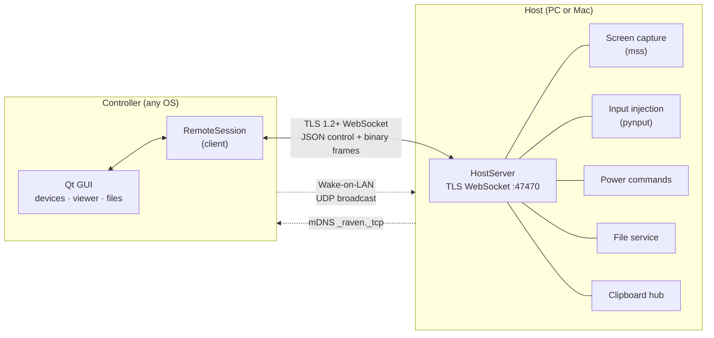
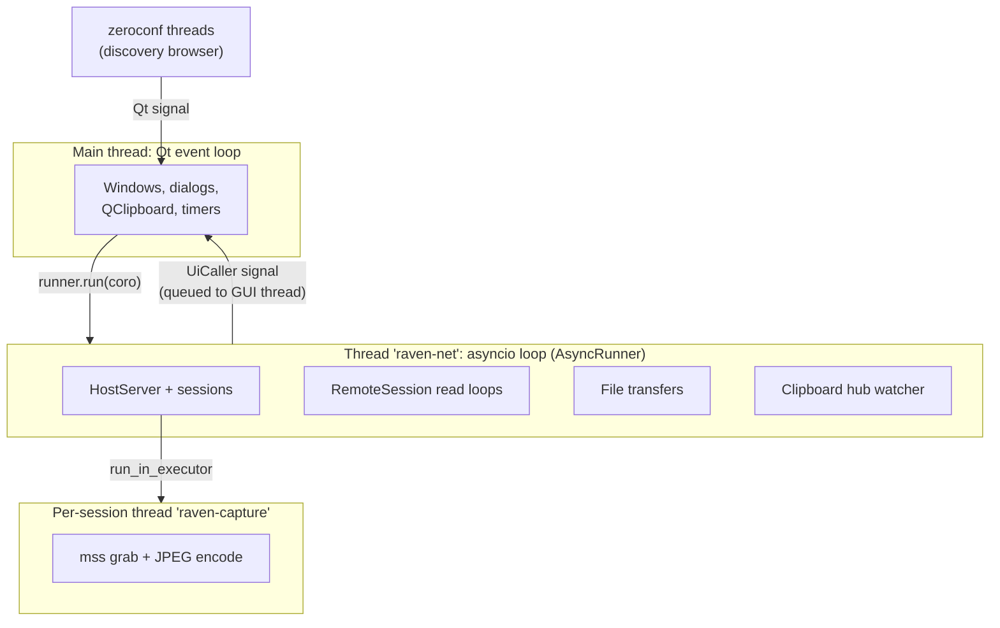
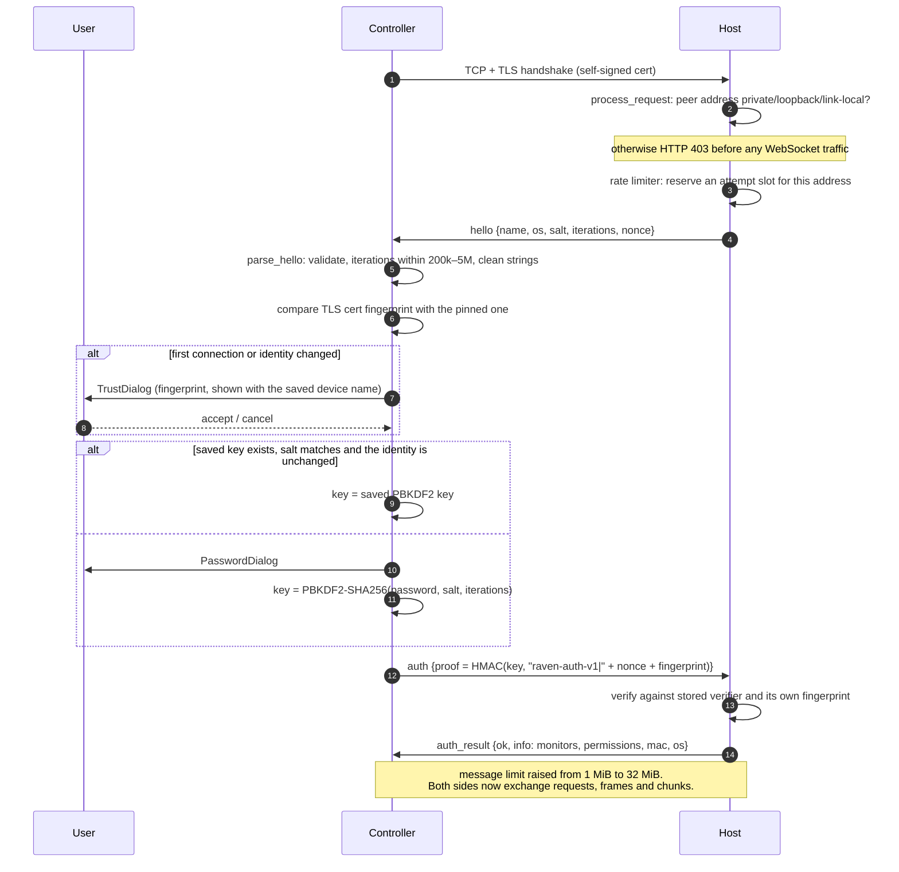
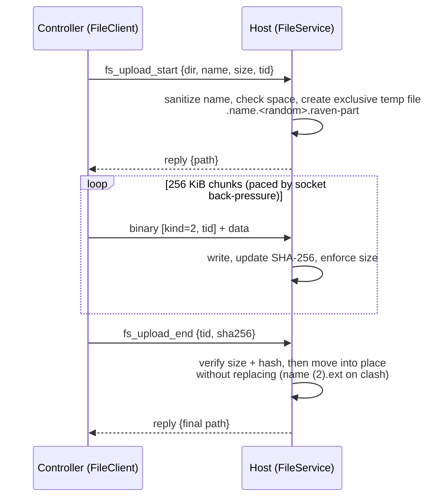
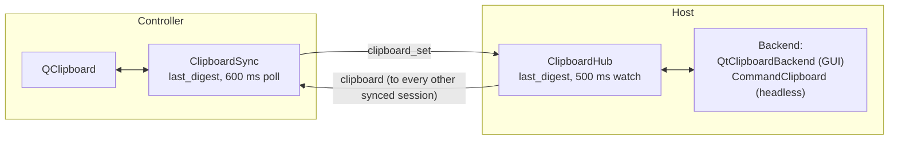

# Raven architecture

This document explains how Raven is put together: the processes and threads, how a
connection is made and secured, and how each feature works end to end. For the exact
message formats see [PROTOCOL.md](PROTOCOL.md). For the libraries and why they were
chosen see [TECH_STACK.md](TECH_STACK.md).

- [Goals and constraints](#goals-and-constraints)
- [System overview](#system-overview)
- [Code map](#code-map)
- [Runtime model: threads and event loops](#runtime-model-threads-and-event-loops)
- [Connection lifecycle](#connection-lifecycle)
- [Features](#features)
  - [Screen streaming](#screen-streaming)
  - [Mouse and keyboard](#mouse-and-keyboard)
  - [Power control and Wake-on-LAN](#power-control-and-wake-on-lan)
  - [File transfer](#file-transfer)
  - [Clipboard sync](#clipboard-sync)
  - [Discovery and device status](#discovery-and-device-status)
- [Security architecture](#security-architecture)
- [Persistence](#persistence)
- [User interface](#user-interface)
- [Packaging and CI](#packaging-and-ci)
- [Testing](#testing)
- [Design decisions](#design-decisions)
- [Extending Raven](#extending-raven)
- [Limitations and future work](#limitations-and-future-work)

## Goals and constraints

**Goals**

- Control your own computers (Windows, macOS, and Linux for development) from each other:
  see the screen, use the mouse and keyboard, sleep, lock, restart, shut down, wake,
  transfer files and share the clipboard.
- One app on every machine. Each machine can be a **host** (being controlled), a
  **controller** (controlling others), or both at once.
- Zero setup beyond choosing a password. Hosts are found automatically on the LAN.

**Constraints**

- **Local network only.** No accounts, cloud relay, NAT traversal or port forwarding.
  The host rejects any peer whose address isn't private, loopback or link-local.
- **Secure by default on an untrusted LAN.** Assume other devices on the network may be
  hostile. Everything is encrypted, the password never crosses the wire, and an
  impersonating host must not be able to harvest it.
- **Runs in the logged-in user's session.** Raven is a normal desktop app, not a system
  service. Capturing the screen and injecting input are tied to the user session on
  macOS and Windows.

## System overview



Every connection is a single WebSocket over TLS. JSON text messages carry control
traffic (login, input, requests and replies). Binary messages carry screen frames and
file chunks. Discovery (mDNS) and Wake-on-LAN magic packets are the only traffic outside
that connection.

## Code map

```
raven/
├── __init__.py          app name, version, protocol version, default port, mDNS service type
├── __main__.py, cli.py  entry points: GUI (default), `host`, `power`, `wake`
├── config.py            settings dataclasses + JSON store, per-OS config directory
├── security.py          certificates, PBKDF2/HMAC proofs, LAN filter, rate limiter, name cleaning
├── protocol.py          JSON encode/decode, binary frame and chunk headers
├── clip.py              clipboard contents on the wire (text / PNG), digests, limits
├── discovery.py         mDNS advertise (host) and browse (controller)
├── wol.py               Wake-on-LAN magic packets
├── autostart.py         start at login (Windows Run key, macOS LaunchAgent)
├── host/
│   ├── server.py        HostServer: TLS listener, LAN filter, login, per-session dispatch,
│   │                    streaming loop, input/power/files/clipboard handlers
│   ├── service.py       HostService = HostServer + mDNS advertiser, started/stopped together
│   ├── files.py         FileService: listing, uploads, downloads, safe names, temp files
│   └── clipboard.py     ClipboardHub: one watcher shared by all synced sessions
├── client/
│   ├── session.py       RemoteSession: connect, validate hello, authenticate, route messages
│   └── files.py         FileClient: browse, upload/download files and folders with progress
├── platform/            OS integration, no Qt
│   ├── capture.py       mss capture → JPEG, Monitor geometry and coordinate mapping
│   ├── inputs.py        pynput mouse/keyboard injection with held-key tracking
│   ├── power.py         per-OS sleep/lock/restart/shutdown strategies
│   ├── clipboard.py     OS change counters; text-only command-line clipboard backend
│   ├── permissions.py   macOS Screen Recording / Accessibility status and prompts
│   └── netinfo.py       LAN addresses, MAC address for WoL, broadcast addresses
└── gui/                 PySide6 desktop app
    ├── app.py           MainWindow (sidebar + pages), tray icon, run_gui()
    ├── async_bridge.py  AsyncRunner (network thread) and UiCaller (back to the GUI thread)
    ├── devices_page.py  device cards, discovery, reachability probes, power/wake actions
    ├── host_page.py     HostController + "This computer" page (switches, activity feed)
    ├── connect_flow.py  connect → trust → password → authenticate, with dialogs
    ├── viewer.py        remote screen window: ScreenView input capture, top bar, transfers
    ├── files_window.py  remote file browser
    ├── transfers.py     transfer progress rows shared by viewer and files window
    ├── clipboard.py     Qt clipboard backend (host) and ClipboardSync (viewer)
    ├── keymap.py        Qt key events → portable key names
    ├── theme.py         light/dark palettes, application stylesheet
    ├── icons.py         inline SVG line icons tinted to the theme
    └── widgets.py       Card, ToggleSwitch, IconButton, Toast, FlowLayout, plain-text helpers
```

Dependency direction: `gui` → `client`/`host` → `platform` → shared modules
(`security`, `protocol`, `config`, `clip`). The `host`, `client` and `platform` packages
never import Qt, so the headless `raven host` runs without a GUI and all protocol logic
is testable without a display.

## Runtime model: threads and event loops



- **The GUI thread** owns every widget and the system clipboard, which Qt allows only
  there.
- **One asyncio loop** runs on a background thread (`AsyncRunner`). It runs all
  networking: the host server, controller sessions and transfers.
  - GUI code starts work with `runner.run(coro, on_done, on_error)`.
  - Results come back through `UiCaller`, a QObject whose signal is delivered on the
    GUI thread.
- **Screen capture** runs in a single-thread executor per session, because `mss`
  handles must stay on the thread that created them. JPEG encoding happens there too,
  so the event loop never blocks on image work.
- **Frames are decoded** into `QImage` on the network thread, which Qt allows for
  QImage (not QPixmap), and then handed to the GUI by signal.
- **Host-side Qt clipboard access** (`QtClipboardBackend`) uses the same bridge in
  reverse: network-thread coroutines run a function on the GUI thread and await its
  result through a `concurrent.futures.Future`.
- **Callbacks that may run late.** Callbacks that may fire after a window closes check
  an `_alive` flag and tolerate deleted Qt objects. One-shot timers are parented to
  their widget, so destroying the widget cancels them.

**The headless host** (`raven host`) skips Qt entirely. It runs `HostService` with
`asyncio.run` in the main thread, and syncs the clipboard through the command-line
backend.

## Connection lifecycle



Notes:

- **Address changes.** If a saved device doesn't answer at its saved address and
  discovery has seen it elsewhere, `ConnectFlow` tries those other addresses. It uses one
  only if its TLS fingerprint equals the pinned one, and it never shows a prompt about
  such an address. The new address is saved only after a successful login.
- **Wrong password.** After a failed login the host closes the connection. The
  controller reconnects (it gets a fresh nonce) and asks again, up to 3 times.
- **Session routing.** After login, `RemoteSession` starts a single read loop. Each
  incoming message goes to exactly one place:
  - replies to `request()` calls, matched by `rid`;
  - file transfer queues, matched by `tid`;
  - screen frames, to the viewer, with an `ack` sent back for each;
  - everything else, to message listeners.

## Features

### Screen streaming

```
mss.grab(monitor) ──► bytes unchanged? ──yes──► send only cursor position if it moved
       │                    │no
       │                    ▼
       │        Pillow: BGRX → RGB, resize to max_width, JPEG(quality)
       │                    ▼
       └──────── wait until < 2 frames are un-acked ──► binary frame [kind=1, cursor x,y, JPEG]
```

- **Request.** The controller sends `stream_start {monitor, fps, quality, max_width}`.
  The viewer presets are Fast (1280 px, quality 50, 20 fps), Balanced (1920 px, 65,
  15 fps) and Sharp (2560 px, 80, 12 fps). The host clamps every value.
- **Change detection.** A frame is sent only if the raw pixels changed. A static
  screen costs almost nothing, and the viewer shows "idle".
- **Flow control.** The host keeps at most 2 frames un-acknowledged, so a slow network
  lowers the frame rate instead of building a backlog. If acks stop arriving for 5
  seconds, the window resets.
- **Cursor.** The host sends the pointer position inside each frame header, or as a
  separate `cursor` message when only the pointer moved. The viewer draws it whenever
  your local pointer isn't over the view.
- **Coordinates.** Mouse positions travel as 0–1 fractions of the monitor, and the host
  maps them to its own coordinates (`Monitor.denormalize`).
  - On macOS, mss monitor geometry is in points and pynput also works in points, so
    Retina screens map correctly.
  - On Windows, the process is per-monitor DPI-aware (mss and Qt both enable it), so
    both libraries use physical pixels.

### Mouse and keyboard

- **Key events.** `ScreenView` turns Qt events into portable key names
  (`gui/keymap.py`):
  - a single printable character for letters, digits and symbols;
  - a pynput `Key` member name such as `enter`, `ctrl`, `cmd` or `f5` for special keys.

  Letters are always sent unshifted, because Shift travels as its own key. That keeps
  Ctrl/Cmd shortcuts intact.
- **Modifier mapping.** `AA_MacDontSwapCtrlAndMeta` makes Control mean `ctrl` and
  Command/Windows mean `cmd` on every OS. The viewer's *Swap ⌘/Ctrl* toggle swaps them
  when Mac and PC are mixed.
- **Key repeat.** Auto-repeat presses are forwarded and auto-repeat releases dropped,
  because injected key-down events don't auto-repeat on the host.
- **Validation.** The host accepts only key names from an allow-list
  (`platform/inputs.py`), mouse buttons `left`, `right` and `middle`, and clamped
  coordinates and scroll amounts. `type_text` is capped at 10,000 characters.
- **No stuck keys.** The viewer sends `release_all` when it loses focus, and the host
  calls `release_all()` when a session ends.
- **Mouse moves** are coalesced on the controller every 15 ms. Scroll uses wheel notches
  (`angleDelta / 120`), and the host carries fractional amounts over so trackpads work.

### Power control and Wake-on-LAN

`platform/power.py` tries each strategy in order until one succeeds. The host replies
`power_result ok` *first* and runs the command 1 second later, so the reply reaches the
controller before the network goes down.

| Action | Windows | macOS | Linux |
|---|---|---|---|
| sleep | `SetSuspendState` (hibernates if hibernation is on) | `pmset sleepnow` | `systemctl suspend` |
| lock | `LockWorkStation` | `pmset displaysleepnow` | `loginctl lock-session` |
| restart | `shutdown /r /t 0` | System Events `restart`, else `sudo -n shutdown -r now` | `systemctl reboot` |
| shutdown | `shutdown /s /t 0` | System Events `shut down`, else `sudo -n shutdown -h now` | `systemctl poweroff` |

Wake-on-LAN (`wol.py`):

- After login the host reports the MAC address of the interface the controller reached
  (`netinfo.mac_for_address`).
- The controller stores it and broadcasts the magic packet (6 × `FF` + 16 × MAC) to
  `255.255.255.255` and to the subnet's directed broadcast, on UDP ports 9 and 7.

### File transfer



- **Downloads** mirror uploads: `fs_download` returns the size, then the host streams
  chunks and finishes with `fs_done {size, sha256}`. The controller writes to its own
  temp file and renames it only if both match.
- **Folders.**
  - *Upload:* the controller walks the local tree with `os.walk` (which doesn't follow
    links). It recreates folders with `fs_mkdir`, then uploads each file.
  - *Download:* the controller first plans the tree with `fs_list`. It skips links to
    other folders, so a link loop can't recurse forever, and caps the plan at 32 levels
    and 100,000 entries.
- **Safety.**
  - Both sides reduce names to one safe path component (`host/files.py:sanitize_name`).
    That removes path separators, `..`, Windows-reserved characters and device names
    such as `CON`, and invisible or text-direction characters.
  - Temp files are created with `O_EXCL` and moved into place with an atomic hard link
    (POSIX) or rename (Windows). Neither replaces an existing file, so concurrent
    same-name transfers can't overwrite each other.
  - Disconnecting aborts open uploads and deletes their temp files.
- **Concurrency.** Transfers share the session's single WebSocket with the screen
  stream. Upload chunks are processed in order; each download runs as its own task.

### Clipboard sync



- **Opt-in per session.** `clipboard_sync {enabled}` subscribes a session to the host's
  single `ClipboardHub`. Whatever is on either clipboard at that moment isn't sent; only
  later copies are.
- **Change detection.** The hub and `ClipboardSync` watch cheap change tokens: Qt's
  `dataChanged` count plus the OS counter (macOS `NSPasteboard.changeCount`, Windows
  `GetClipboardSequenceNumber`). They read and hash the clipboard only when a token
  changes. The OS counter matters on macOS, where Qt may report changes late while the
  app is in the background.
- **No ping-pong.** Each side remembers the digest of what it last sent or applied and
  ignores a clipboard change carrying that same digest. Images are hashed by **pixels**
  (`gui/clipboard.py:image_digest`), because two PNG encoders can produce different
  bytes for the same picture. Changes are also ignored for 400 ms after the controller
  writes its own clipboard.
- **Formats and limits.** Text (up to 4 M characters) or a PNG image (up to 16 MB).
  When a copy has both, text wins, so spreadsheet cells come through as text. The
  headless host supports text only.

### Discovery and device status

- **Advertising.** A host advertises `_raven._tcp.local.` (IPv4) with TXT properties
  `name`, `os`, `fp` (certificate fingerprint) and `v` (protocol version).
- **Browsing.** Controllers browse with zeroconf. Advertisements are **unauthenticated**,
  so they are only used to show cards; names are cleaned and length-capped first.
  - They are never used to change a saved device's address.
  - Once a saved device has a pinned identity, an advertisement claiming that
    fingerprint at a new address becomes a *candidate* address (see
    [Connection lifecycle](#connection-lifecycle)).
- **Online status** comes from discovery plus a TCP connect probe to each saved device
  every 20 seconds (1.5-second timeout). The probe never sends data, so hosts don't log
  it.

## Security architecture

### Threat model

| Adversary | Can | Must not be able to |
|---|---|---|
| Anyone on the internet | Reach a port that was forwarded by mistake | Get past the address filter |
| Unauthenticated device on the LAN | Connect to the port, send mDNS adverts, sniff and spoof traffic | Log in, read traffic, harvest a crackable password proof, redirect saved devices, run code through UI rendering |
| Host impersonator (after the user clicks through a warning) | Present its own certificate and hello | Obtain a cheaply crackable proof, or receive a saved key automatically |
| Authenticated controller | Everything the host's permission switches allow | Bypass a switched-off permission, or write files outside the chosen folder |

The host controls each permission separately: input, power, files and clipboard. An
authenticated controller with every permission on has the rights of the logged-in user
by design.

### Controls

| Control | Where |
|---|---|
| Peer address must be private, loopback or link-local (rejected with HTTP 403 before the WebSocket handshake) | `HostServer._check_origin`, `security.is_lan_address` |
| TLS ≥ 1.2 with a per-host EC P-256 self-signed certificate (10-year validity) | `security.ensure_certificate`, `server_ssl_context` |
| Certificate pinning: trust on first use; changed identity → warning and password re-entry | `ConnectFlow._trust`, `cli._run_power` |
| Password never sent: `HMAC-SHA256(PBKDF2-SHA256(pw, salt, 200k), "raven-auth-v1\|" + nonce + fingerprint)` | `security.make_proof`/`verify_proof` |
| Proof bound to the TLS fingerprint, so a man-in-the-middle can't relay it | the `fingerprint` input of the proof |
| Host-chosen iteration count limited to 200k–5M; salt and nonce at least 16 bytes | `client.session.parse_hello` |
| Saved key used only for the identical pinned fingerprint | `ConnectFlow._connected` |
| Rate limiting: 5 attempts per minute per address and 30 failures per minute per host, with each slot reserved before the attempt is evaluated | `security.AuthRateLimiter` |
| Messages limited to 1 MiB before login, 32 MiB after | `serve(max_size=…)`, raised after login |
| Separate permission switches, checked on every message | `_Session.dispatch` and its handlers |
| Remote strings displayed as plain text only; control and text-direction characters removed | `widgets.label`, `Toast`, `plain_tooltip`, `confirm`, `security.clean_display_name` |
| Safe file names; exclusive temp files; moves that never replace; folder links skipped | `host/files.py`, `client/files.py` |
| Host-side activity log and notifications; "Disconnect all" | `HostPage` |

### Secrets at rest

- **The host** stores only the PBKDF2 *verifier* (salt + derived key), never the
  password. It also keeps its TLS private key (`0600` on POSIX).
- **"Remember password"** on a controller stores the derived key for that host, not the
  password.
- `settings.json` is written atomically with `0600` permissions on POSIX.
- The derived key is password-equivalent *for that host only*. It is protected by
  file-system permissions, not encrypted.

## Persistence

| OS | Config directory |
|---|---|
| Windows | `%APPDATA%\Raven` |
| macOS | `~/Library/Application Support/Raven` |
| Linux | `$XDG_CONFIG_HOME/raven` or `~/.config/raven` |
| any | overridden by `RAVEN_HOME` (used by the tests) |

Files: `settings.json`, `host-cert.pem`, `host-key.pem`.

`settings.json` holds:

```json
{
  "host": {
    "enabled": true, "name": "Office PC", "port": 47470,
    "password_salt": "<hex>", "password_verifier": "<hex>",
    "allow_input": true, "allow_power": true, "allow_files": true,
    "allow_clipboard": true, "advertise": true
  },
  "remotes": [
    { "id": "<uuid>", "name": "MacBook Pro", "address": "192.168.1.31", "port": 47470,
      "os": "macos", "mac": "a4:83:e7:12:34:56", "fingerprint": "AB:CD:…",
      "saved_key": "<hex or empty>", "saved_salt": "<hex or empty>" }
  ]
}
```

Unknown keys are ignored when loading, so older and newer versions can read each other's
files.

**Start at login:**

- *Windows:* the `HKCU\Software\Microsoft\Windows\CurrentVersion\Run` value `Raven`.
- *macOS:* the LaunchAgent `~/Library/LaunchAgents/com.raven.host.plist`.

Both launch Raven with `--minimized`, so it goes straight to the tray when remote access
is on.

## User interface

- **Shell:** `MainWindow` has a sidebar (brand, navigation, a remote-access status chip)
  and a `QStackedWidget` with two pages:
  - **Devices** (`DevicesPage`): responsive `FlowLayout` grid of `DeviceCard`s.
  - **This computer** (`HostPage`): remote-access switch, permission switches,
    name/port/password, macOS permissions, activity feed.
- **Tray:** while remote access is on, closing the window keeps Raven running in the
  tray.
- **Windows opened from a card:**
  - `ViewerWindow`: a `ScreenView` with a dark top bar of `IconButton`s, transfer cards,
    toasts and a reconnect overlay.
  - `FilesWindow`: places sidebar, sortable tree, transfer list.
- **Theme** (`gui/theme.py`):
  - Qt's Fusion style, plus an application stylesheet generated from a `Palette` of
    colour tokens, plus a matching `QPalette`.
  - Follows `QStyleHints.colorScheme()` and switches live. `RAVEN_THEME=light|dark`
    overrides it.
- **Icons** are inline SVG paths tinted at paint time (`IconButton`, `Avatar`) or through
  `icons.bind()`, so they follow theme changes.
- **Plain-text policy.** Every label, toast, tooltip and confirmation that can contain
  remote data is plain text (`widgets.label`, `plain_tooltip`, `confirm`).
  - New UI code should use these helpers rather than `QLabel(text)` or the static
    `QMessageBox` functions.
  - This is a security control, not a style preference: Qt renders anything that looks
    like HTML as rich text, including `` tags that load files.

## Packaging and CI

- **Bundles.** `packaging/raven.spec` (PyInstaller) builds a one-folder `Raven.exe` on
  Windows and `Raven.app` on macOS. The macOS bundle's `Info.plist` declares
  `NSAppleEventsUsageDescription` (for the System Events shutdown/restart),
  `NSLocalNetworkUsageDescription` and `NSBonjourServices`.
- **CI** (`.github/workflows/build.yml`), on pushes to `main`, on pull requests and on
  manual runs:
  1. `test`: Ubuntu, Python 3.12, `xvfb-run -a pytest -q`.
  2. `package`: Windows and macOS, PyInstaller, uploads `Raven-Windows.zip` /
     `Raven-macOS.zip` as artifacts. Runs only if `test` passes.
  3. `release`: only on a `v*` tag. Attaches both zips to a GitHub Release, which the
     website's download buttons point at (`releases/latest/download/<file>`).
- **Website**: the static site in `site/` (plain HTML and CSS, no build step) is served
  by Vercel via `vercel.json`; there is no workflow for it.
- **Not code-signed.** The bundles aren't signed or notarized yet. macOS needs
  right-click → Open the first time, and Screen Recording/Accessibility grants are tied
  to the binary's signature, so re-grant them after each rebuild.

## Testing

| Suite | What it covers |
|---|---|
| `test_security.py` | LAN filter, proof round trip, certificate stability, rate limiter, settings round trip |
| `test_platform.py` | power plans for every OS/action, monitor mapping, JPEG scaling, frame packing, key validation, WoL packets |
| `test_end_to_end.py` | real TLS host + controller: wrong password, lockout, streaming, input, permissions, power, proof bound to the certificate |
| `test_files.py` | uploads and downloads of files and nested folders, checksums, name clashes, streaming during a transfer, cancel cleanup |
| `test_clipboard.py` | both directions, images, no echo, two controllers, sync off, host switch, large images after login |
| `test_keymap.py` | Qt key events → portable names (offscreen Qt) |
| `test_attacks.py` | 47 attacks against a live host: pre-login garbage, replay, parallel guessing, permission bypass, malformed and fuzzed messages, path traversal, upload integrity, concurrent uploads, link loops |
| `test_client_safety.py` | controller protections: iteration floor, hello validation, plain-text rendering, no saved key after an identity change, verified alternate addresses, mDNS can't rewrite saved devices |

- `tests/support.py` provides fakes (capturer, injector, clipboard) and a `host` fixture
  that runs a real `HostServer` on `127.0.0.1`.
- GUI tests use offscreen Qt and delete their windows after each test.
- Run everything with `pytest` (on headless Linux, `xvfb-run -a pytest`).

## Design decisions

| Decision | Why | Alternatives considered |
|---|---|---|
| Python + PySide6 for both sides | One codebase for Windows, macOS and Linux; mature libraries for capture, input and mDNS; a native-feeling desktop UI | Electron (needs native input modules), Rust/Tauri (slower to build), Go (cgo for input) |
| One WebSocket per session, JSON control + binary frames | Simple framing, built-in back-pressure, TLS from the standard library, easy to debug | Raw TCP with custom framing; WebRTC (needs signalling and STUN, overkill on a LAN) |
| JPEG frames with change detection | Small code, good quality on a LAN, no codec dependency | H.264/VP8 encoding (lower bandwidth but heavy dependencies and latency tuning) |
| Self-signed certificates + pinning | No CA or accounts; fits LAN-only use | A pre-shared key without TLS (no forward secrecy); a private CA (setup burden) |
| HMAC challenge–response instead of sending the password | The password never leaves the machine, even to an impostor | SRP or PAKE (stronger against offline attack, but needs extra dependencies) |
| asyncio on one background thread | All network state on one thread; Qt stays responsive | qasync (one loop shared with Qt; couples networking to the GUI) |
| Host-side permission switches checked per message | The owner can lock down a host without restarting it | Fixed at connect time (couldn't be revoked mid-session) |

## Extending Raven

**A new control message**

1. Handle it in `_Session.dispatch` (`host/server.py`).
   - Check the relevant `allow_*` setting first, and clamp or validate every field.
   - If the controller needs an answer, reply with `self.reply(msg, payload | error=…)`.
2. On the controller, send it with `session.send(...)`, or with
   `await session.request(...)` if it needs a reply.
3. Document it in [PROTOCOL.md](PROTOCOL.md).
4. Add a test in `test_end_to_end.py`, and an abuse case in `test_attacks.py`.

**A new permission**

1. Add an `allow_*` field to `HostSettings` (`config.py`), defaulting to safe behaviour.
2. Include it in the `auth_result.info` that `_Session.run` sends.
3. Add a `SettingRow` with a switch on `HostPage`.
4. Gate the handlers on it.

**A new OS integration**

- Put it in `platform/` with no Qt imports.
- Import optional OS libraries lazily, so the rest of the app works without them.

**UI showing remote data**

- Build text with `widgets.label`, tooltips with `plain_tooltip` and confirmations with
  `confirm`.

## Limitations and future work

- **Session and permissions:**
  - Raven runs in the user session, so the login screen and the Windows UAC secure
    desktop can't be controlled.
  - Input can't reach elevated windows unless Raven runs as administrator.
- **Platform behaviour:**
  - Windows *Sleep* hibernates when hibernation is enabled.
  - macOS *Lock* relies on "require password immediately".
  - Newer macOS versions may periodically ask the user to re-confirm screen-recording
    permission.
- **Missing features and protocol limits:**
  - No audio, no multi-monitor stitching, no file-timestamp preservation.
  - IPv4-only discovery.
- **Possible future work:**
  - A video codec for lower bandwidth.
  - PAKE-based login (for example SPAKE2) to remove the offline-guessing risk entirely.
  - Signed and notarized builds.
  - A privileged helper for the login screen.
